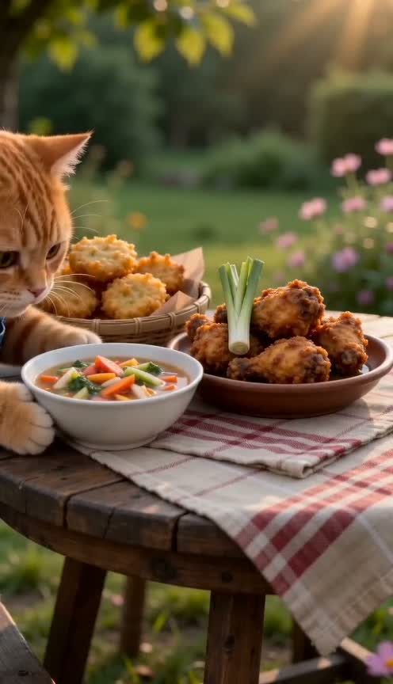
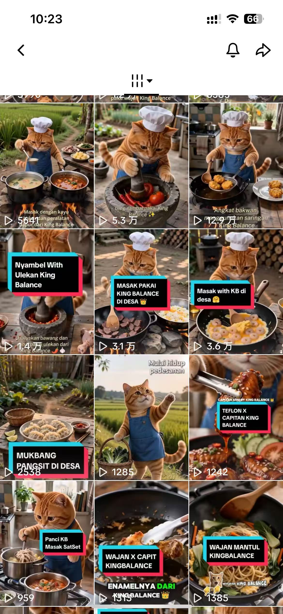

# CatChef AI Video Pipeline

一个面向印尼 TikTok 的本地 Python 工作流：让橘猫制作印尼菜，并在内容中自然呈现厨具。程序生成 6 段分镜提示词和视频，支持任务续跑、画质增强与 FFmpeg 合成。可先用 mock 模式体验，再自行配置付费 API。

## 项目背景

团队主要推广厨具，想尝试适合海外 TikTok 的内容形式。我看到国内“胖大橘”一类橘猫视频受到欢迎，也注意到中国 AI 角色视频会被传播到海外，于是和主管、同事讨论：能否用橘猫做饭的形式，制作面向印尼用户的原创内容，并让厨具自然出现在做饭场景里。

最初发布的是 15 秒的单道菜视频，播放和评论互动都比较普通。后来争取了更长的生成时长，增加菜品和一两个能引发讨论的小插曲，例如橘猫拿鸡蛋时被鸡啄、取食材时被意外打断。使用这套工作流制作的橘猫内容中，出现过上万播放的视频。

制作过程中，选菜、写脚本与分镜、把橘猫参考图和提示词交给视频模型、下载并拼接片段，是反复发生的步骤。因此把这条链路整理成了可交接的自动化流程，减少重复操作，也方便新人接手。针对 6 段 15 秒视频容易出现时间跳变、菜品外观不一致的问题，我在提示词中统一场景时间，并把已完成菜品的外观描述延续到后续片段，改善了成片的连贯性。

## 工作流程

```text
菜品列表 + 提示词模板
        ↓
大模型生成完整脚本 → 拆分为 6 段提示词
        ↓
Seedance 生成 6 段视频 → state.json 记录任务与续跑状态
        ↓
可选：AI MediaKit 分段超分
        ↓
FFmpeg 本地合成 90 秒视频
```

## 项目实现

- 用独立模块处理配置校验、菜单选择、提示词构建与分段、API 调用、状态管理和视频合成。
- 通过 `state.json` 保存每段任务的 ID、状态和结果；重新运行时可查询已有任务，跳过已完成的真实视频。
- 真实 Seedance 和超分调用分别需要显式指定 `--real-video`、`--real-super-res`，避免 mock 调试时误调用收费接口。
- 提供 Windows 操作菜单，以及命令行方式选择单个或多个 Part。

技术栈：Python 3.10+、火山方舟大模型与 Seedance API、AI MediaKit API、FFmpeg、PyYAML、Requests。

## 橘猫内容展示

下面是从一次完整真实运行中选出的成片和画面：

[观看约 90 秒的实际生成成片](assets/showcase/catchef-real-90s.mp4)

| 采摘食材 | 制作过程 | 成品展示 |
| --- | --- | --- |
|  |  |  |

以下是橘猫账号的发布截图，展示内容形式和互动情况。

| 发布内容 | 单条内容互动 |
| --- | --- |
|  |  |

## 本地快速体验（不调用付费 API）

环境：Windows PowerShell。以下命令均在仓库根目录执行。

```powershell
py -3 -m venv .venv
.\.venv\Scripts\python.exe -m pip install -r requirements.txt
.\.venv\Scripts\python.exe main.py --mock-llm --prompt-only
```

预期结果：`outputs/` 下新建一个目录，包含菜单、完整提示词、`part1_prompt.txt` 到 `part6_prompt.txt` 和 `state.json`。这一步不会生成视频。

如果要体验视频任务的状态流转，可运行：

```powershell
.\.venv\Scripts\python.exe main.py --with-video --mock-llm --mock-video --parts 1
```

预期结果：新输出目录中出现 `part1.mp4` 占位文件，`state.json` 将其标记为 mock。占位文件不可播放，也不能作为真实视频参与合成。

真实生成需要自行设置 `ARK_API_KEY`；真实超分另需 `AMK_API_KEY`，并可能产生费用。完整配置、单段验证、续跑和合成命令见 [操作手册](docs/操作手册.md)。

## 目录说明

| 路径 | 作用 |
| --- | --- |
| `main.py` | 命令行入口与流程编排 |
| `src/clients/` | 大模型、Seedance 和 AI MediaKit 客户端 |
| `src/state_manager.py` | 任务状态读写与续跑判断 |
| `src/video_composer.py` | FFmpeg 视频合成 |
| `操作菜单.bat` | Windows 菜单入口 |
| `docs/` | [操作手册](docs/操作手册.md)，包含命令行、Windows 菜单、配置和常见问题 |

日常运行产生的视频、提示词和任务状态保存在本机 `outputs/`，不会自动纳入仓库；上面展示的成片和画面是人工挑选后复制到 `assets/showcase/` 的案例。`assets/orange_cat.png` 是视频生成时使用的角色参考图。
