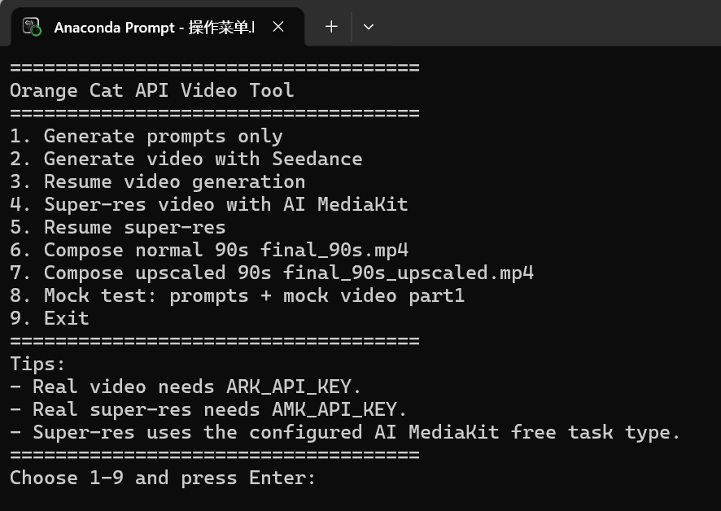

# CatChef AI Video Pipeline 操作手册

本手册面向第一次接手项目的同事，按“准备环境 → 测试 → 检查提示词 → 生成视频 → 续跑 → 合成”的顺序操作。所有命令都在仓库根目录执行；示例中的 `outputs\某个文件夹` 必须换成实际生成的目录。普通视频和超分视频都需要人工检查效果。

## 1. 项目会生成什么

程序从 `dishes.txt` 随机选菜，填入 `prompt_template.txt`，调用大模型生成一份完整提示词，再拆为 6 段 15 秒提示词。每段可单独提交 Seedance 生成视频，进度保存在 `state.json`；真实视频全部完成后，可用 FFmpeg 合成约 90 秒成片，也可先经 AI MediaKit 分段超分再合成高清版。

```text
outputs/本次菜品目录/
  menu.txt                 本次选择的菜品
  filled_prompt.txt        发给大模型的输入
  prompt_full.txt          大模型的完整输出
  part1_prompt.txt ... part6_prompt.txt
  state.json               视频及超分任务状态
  part1.mp4 ... part6.mp4   真实模式生成的视频
  final_90s.mp4            可选：普通版合成视频
  part1_upscaled.mp4 ... part6_upscaled.mp4
  final_90s_upscaled.mp4   可选：高清版合成视频
```

项目入口是 `main.py`；`config.yaml` 管理模型和输出配置；`操作菜单.bat` 为 Windows 菜单入口。`src/clients/` 负责 API 请求，`src/state_manager.py` 负责保存进度，`src/video_composer.py` 负责本地合成。

## 2. 首次准备

### 命令行环境

以下使用 Windows PowerShell。先进入你保存仓库的目录，例如：

```powershell
cd 'D:\Projects\catchef-ai-video-pipeline'
py -3 -m venv .venv
.\.venv\Scripts\python.exe -m pip install -r requirements.txt
```

第一条命令进入项目；第二条创建本地 Python 虚拟环境；第三条安装依赖。预期结果是安装完成且没有报错。需要 Python 3.10 或更高版本。合成视频还需另行安装 FFmpeg，并让 `ffmpeg` 命令可以在终端执行。

### API Key

真实生成提示词或 Seedance 视频时，在当前 PowerShell 窗口设置：

```powershell
$env:ARK_API_KEY='你的火山方舟 API Key'
```

真实超分时还需设置：

```powershell
$env:AMK_API_KEY='你的 AI MediaKit API Key'
```

这些变量仅对当前窗口有效。请勿把真实 Key 写进代码、配置、截图或 Git 提交。设置变量本身不消耗额度；真实提示词和视频生成会产生费用。本项目的超分配置使用 AI MediaKit `free` 任务类型，当时使用未额外收费。

## 3. 标准操作流程

下文以 PowerShell 和 `.\.venv\Scripts\python.exe` 为例。执行目录始终是仓库根目录。

### 第一步：零费用测试

```powershell
.\.venv\Scripts\python.exe main.py --mock-llm --prompt-only
```

预期：`outputs/` 下新增一个目录，其中有 `menu.txt`、`prompt_full.txt`、六个 `partN_prompt.txt` 和 `state.json`。mock LLM 不调用真实大模型。

如需测试视频任务状态，可执行：

```powershell
.\.venv\Scripts\python.exe main.py --with-video --mock-llm --mock-video --parts 1
```

预期：新目录里出现 `part1.mp4` 占位文件，`state.json` 中 `is_mock_video` 为 `true`。这个 `.mp4` 不可播放，不能用于合成。

### 第二步：真实生成并检查提示词

```powershell
.\.venv\Scripts\python.exe main.py --prompt-only
```

预期：终端打印本次输出目录，生成完整提示词和六个 Part。此命令调用大模型，会消耗相应额度，但不会调用 Seedance。

打开该目录的 `part1_prompt.txt` 到 `part6_prompt.txt`，检查菜品、橘猫形象、前后场景、动作、时长和画幅是否合理。若提示词不合适，可调整 `prompt_template.txt` 并重新生成；每次运行会创建新的输出目录。

### 第三步：只生成真实 part1

把下面路径替换为第二步打印的实际目录：

```powershell
.\.venv\Scripts\python.exe main.py --generate-video 'outputs\某个文件夹' --real-video --parts 1
```

预期：提交 Seedance 任务、轮询状态、下载 `part1.mp4`，并在 `state.json` 标记 `status: done`、`is_mock_video: false`。这一步会消耗视频生成额度。若同目录已有 mock 占位文件，真实生成会替换它。

先播放 `part1.mp4`，核对竖屏比例、橘猫外观、声音、动作和菜品是否符合提示词。效果不合适时先调整提示词或配置，再决定是否继续生成其余五段。

### 第四步：续跑其余视频

```powershell
.\.venv\Scripts\python.exe main.py --resume 'outputs\某个文件夹' --real-video --parts all
```

预期：真实完成且文件存在的 part 被跳过；未完成的 part 继续处理。终端中断、网络失败后也可再次执行此命令。只处理一段时，把 `all` 改成对应数字，例如 `--parts 3`。程序会先查询 `running` 或 `failed` 且保存了 `task_id` 的旧任务。

### 第五步：本地合成普通视频

六段真实视频都完成后执行：

```powershell
.\.venv\Scripts\python.exe main.py --compose 'outputs\某个文件夹'
```

预期：生成 `final_90s.mp4`。合成只调用本机 FFmpeg，不消耗 API 额度，也不会删除六个 part。程序会拒绝把 mock 占位文件当作真实视频；若目标文件已存在且配置不允许覆盖，也会停止。

### 可选：超分和高清合成

AI MediaKit 读取 Seedance 返回的临时 `video_url`，建议在链接仍有效时处理。先测试一段，再处理全部：

```powershell
.\.venv\Scripts\python.exe main.py --super-res-parts 'outputs\某个文件夹' --real-super-res --parts 1
.\.venv\Scripts\python.exe main.py --resume-super-res-parts 'outputs\某个文件夹' --real-super-res --parts all
.\.venv\Scripts\python.exe main.py --compose-upscaled 'outputs\某个文件夹'
```

前两条命令调用当前配置的 AI MediaKit `free` 超分任务；最后一条只在本机合成 `final_90s_upscaled.mp4`。超分前需要原始 part 真实完成，且 `state.json` 保存了可用的源视频 URL。mock 超分占位文件不能用于高清合成。

`--parts` 支持 `1`、`1,2`、`4,5,6` 和 `all`；不传时默认 `all`。真实 Seedance 和真实超分必须分别显式传入 `--real-video` 和 `--real-super-res`。

## 4. Windows 操作菜单

`操作菜单.bat` 是给不熟悉命令行的同事准备的入口。它会切换到 BAT 所在的项目目录，并尝试激活名为 `seedance_cat` 的 conda 环境。**第一次使用要先准备环境；不要在没有环境和依赖时直接双击 BAT。** 本节使用 Windows 的 Anaconda Prompt，不是 PowerShell；如果你只使用前文的 `.venv`，请继续按第 3 节的 PowerShell 命令操作。

### 首次使用：先准备，再启动

先安装 Anaconda 或 Miniconda，并确认 `ffmpeg` 已安装且可在 Anaconda Prompt 中运行。打开 **Anaconda Prompt**，按顺序执行以下命令。第一行是这台电脑上新仓库的实际路径；仓库放在别处时，只替换这一行：

```bat
cd /d "D:\Desktop\ai应用工作\橘猫api项目\catchef-ai-video-pipeline"
conda create -n seedance_cat python=3.10 -y
conda activate seedance_cat
python -m pip install -r requirements.txt
ffmpeg -version
操作菜单.bat
```

依次作用与预期：进入仓库根目录；创建 Python 3.10 环境；激活环境；安装项目依赖；确认 FFmpeg 能输出版本；最后打开菜单。`conda create` 只需第一次运行，环境已存在时不要重复创建；之后从 `conda activate seedance_cat` 开始即可。若 BAT 显示 `Conda environment activation failed`，先停止，不要继续选菜单项，检查是否在 Anaconda Prompt 中运行以及环境名是否正确。

**第一次打开菜单先输入 `8` 并回车**：这是 mock 测试，不调用收费 API。看到 `Done` 后按任意键返回菜单，再到新建的 `outputs/` 目录核对 `menu.txt`、六段提示词和 `state.json`。mock 生成的 `part1.mp4` 是不可播放的占位文件，不是实际视频。

启动后应看到如下 1～9 号菜单（Anaconda Prompt 实际运行截图）：



各选项的用途如下：

| 选项 | 功能 | 何时使用 |
| --- | --- | --- |
| 1 | Generate prompts only | 新建一份真实提示词 |
| 2 | Generate video with Seedance | 提示词检查后，先生成 part1 |
| 3 | Resume video generation | 继续生成其他 part 或处理中断 |
| 4 | Super-res video with AI MediaKit | 对真实视频做超分，建议先试 part1 |
| 5 | Resume super-res | 继续超分未完成的 part |
| 6 | Compose normal 90s | 六个真实 part 完成后本地合成 |
| 7 | Compose upscaled 90s | 六个真实超分 part 完成后本地合成 |
| 8 | Mock test | 零费用测试提示词及 part1 占位视频 |
| 9 | Exit | 退出菜单 |

### mock 检查通过后：真实生成

真实生成可能产生费用。先在**启动 BAT 的同一个 Anaconda Prompt 窗口**设置 Key，再启动菜单；不要把 Key 写进仓库文件或截图。仅生成提示词和视频需要 `ARK_API_KEY`，超分才需要 `AMK_API_KEY`：

```bat
cd /d "D:\Desktop\ai应用工作\橘猫api项目\catchef-ai-video-pipeline"
conda activate seedance_cat
set "ARK_API_KEY=你的火山方舟 API Key"
操作菜单.bat
```

推荐顺序：选 `1` 生成并人工检查六段提示词 → 选 `2`、Parts 输入 `1`，只试做第一段 → 播放检查 `part1.mp4` → 满意后选 `3`、Parts 输入 `all` 续跑剩余片段 → 六段真实视频完成后选 `6` 本地合成。需要超分时，另在相同窗口设置 `AMK_API_KEY`，再按 `4`（先试一段）→ `5`（续跑剩余）→ `7`（合成高清版）操作。无需超分可以跳过 `4`、`5`、`7`。

菜单要求输出目录时，输入选项 `1` 所打印的**实际目录**，例如 `outputs\2026-05-18_菜品名`；不要照抄示例目录。要求 Parts 时可输入 `1`、`1,2` 或 `all`；直接回车也表示 `all`。菜单与第 3 节命令行使用同一个项目和 `outputs/`，只需选择一种入口。

## 5. 配置和状态怎么看

| 文件或字段 | 用途 |
| --- | --- |
| `dishes.txt` | 候选印尼菜，每行一个；可用 `#` 写注释 |
| `prompt_template.txt` | 大模型提示词模板；`{{MENU}}` 会换成本次菜单 |
| `config.yaml` → `llm.model` | 大模型名称 |
| `config.yaml` → `seedance.model`、`resolution` | 视频模型和分辨率；当前配置为 `480p` |
| `config.yaml` → `super_resolution.target_resolution` | 超分目标分辨率，当前为 `1080p` |
| `config.yaml` → `compose.overwrite_existing` | 是否允许覆盖已有普通合成视频 |
| `assets/orange_cat.png` | 每个真实视频任务共用的橘猫参考图 |

视频生成前，程序把橘猫参考图转成 data URL，并与每段文字提示词一起发给 Seedance。默认只要求模型参考猫的外观，不要求沿用图片背景和构图。大模型输出必须包含 `【Part 1｜15s】` 到 `【Part 6｜15s】` 六个标题；缺少标题时会保存 `prompt_raw_failed.txt`，不会继续写六段文件。

`state.json` 的每个 part 包含 `status`、`task_id`、`video_path`、`error`、`is_mock_video`。真实完成应同时满足 `status = done`、`is_mock_video = false`、对应 `.mp4` 存在。`pending` 表示待处理，`running` 表示已提交，`failed` 和 `expired` 表示需要排查或续跑。超分进度在 `super_resolution_parts` 下，合成进度在 `compose` 和 `compose_upscaled` 下。不要手工把失败状态改成 `done`。

## 6. 常见问题

- **mock 的 mp4 无法播放？** 它只是占位文件。使用 `--real-video` 才会请求真实视频。
- **终端关闭或任务一直 running？** 云端任务可能仍在运行；重新执行 `--resume`，程序会查询已保存的任务 ID。
- **任务成功却没下载？** 保留 `state.json`，对对应 part 执行 `--resume`，优先查询旧任务。
- **找不到 FFmpeg？** 安装 FFmpeg，并确认在同一个终端运行 `ffmpeg -version` 能输出版本。
- **模型 ID 报错？** 核对 `config.yaml` 中的模型 ID 与账户实际可用的接入点；先只测试 part1。
- **超分提示 URL 为空或过期？** 检查 `state.json` 中原始 part 的 `video_url`，必要时重新生成该 part，并尽快超分。
- **提示词质量差？** 先修改 `prompt_template.txt` 或重跑提示词；不要直接批量生成六段真实视频。

如果仍失败，请保留完整报错、对应输出目录和 `state.json` 供排查。`state.json` 可能含临时视频 URL 和任务 ID，不要直接上传到公开仓库。
